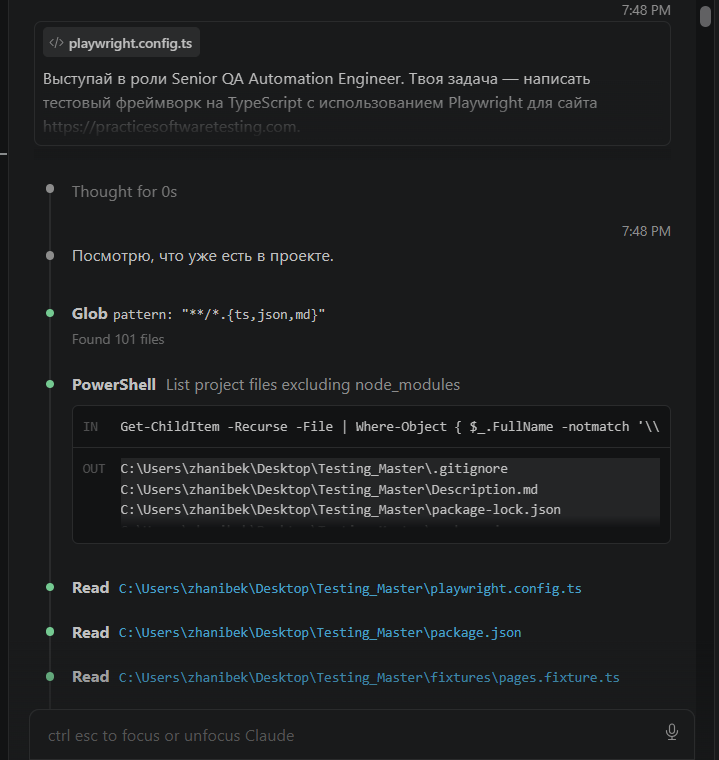
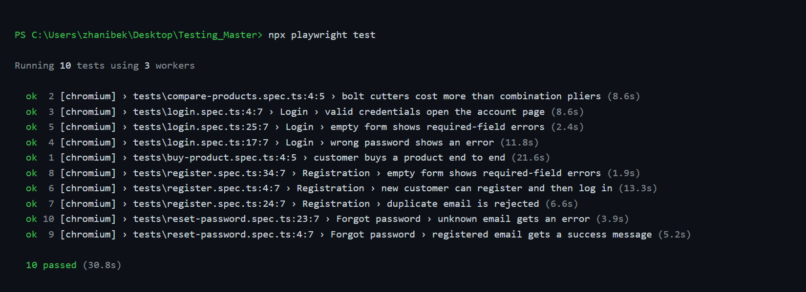
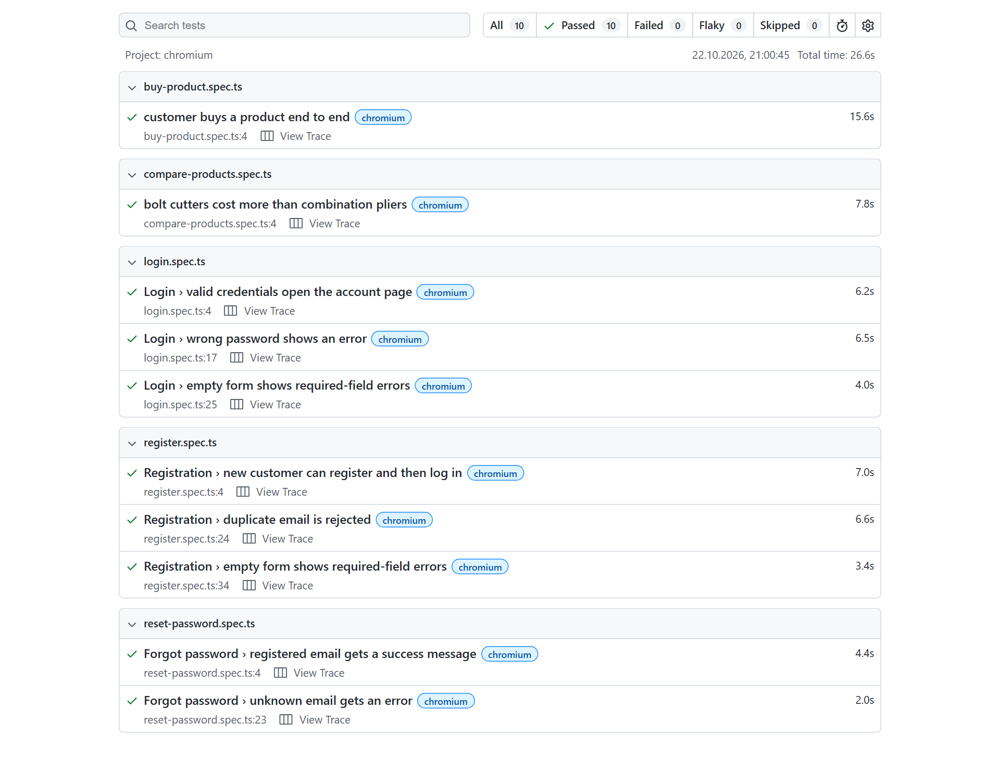
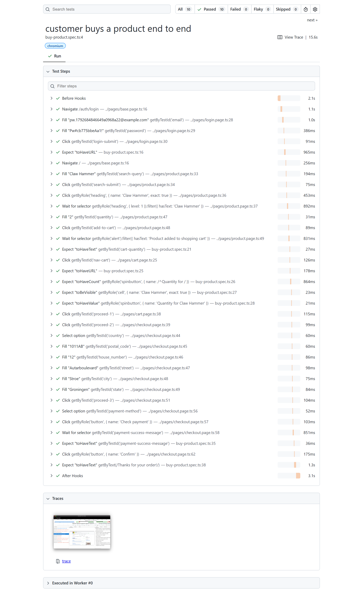
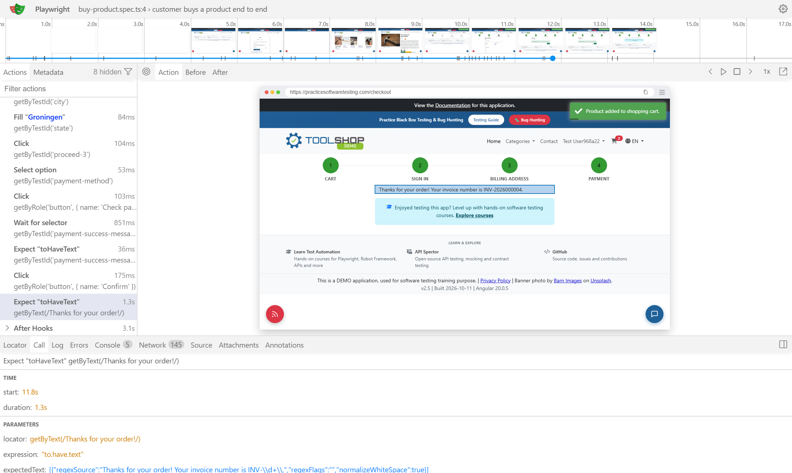

# SIS 2 — Playwright test automation for the Toolshop

[](https://github.com/Zhan1bek/Software_Testing_SIS2/actions/workflows/playwright.yml)

End-to-end tests for <https://practicesoftwaretesting.com> written with **Playwright + TypeScript**.

| Document | What is in it |
|---|---|
| [Description.md](Description.md) | Goal, scope and the full **list of test cases** |
| [Prompt.md](Prompt.md) | The exact AI prompts and the tool/model used |
| [Review.md](Review.md) | What the AI produced, how it was reviewed and changed, and why |
| [AI_CI.md](AI_CI.md) | SIS 3 (CI pipeline): AI tool, model, prompts, and what was checked and changed |
| [screenshots/](screenshots/) | AI answer, run result, HTML report, trace viewer — shown [below](#screenshots) |

## How to run

Requires Node.js 20+.

```bash
npm install
npx playwright install chromium
npx playwright test          # all tests, headless
npx playwright test --ui     # UI mode: pick tests, time-travel through steps
npx playwright show-report   # open the last HTML report
```

No accounts or secrets are needed: every test creates its own customers.

## CI

**CI system:** GitHub Actions. The repository already lives on GitHub, so there is no server to run
or maintain (Jenkins would need one, and a local Jenkins cannot even receive GitHub webhooks).
It is free for a public repository, and its job matrix gives sharding with no extra tooling.

**Pipeline** ([.github/workflows/playwright.yml](.github/workflows/playwright.yml)):

```
push / pull_request
        │
        ├── Tests (shard 1/4) ─┐
        ├── Tests (shard 2/4) ─┤   checkout → setup-node (npm cache) → npm ci
        ├── Tests (shard 3/4) ─┤   → playwright install --with-deps chromium
        └── Tests (shard 4/4) ─┘   → playwright test --shard=i/4 → upload artefacts
                               │
                               └── Merge reports   blob reports of all shards → one HTML + one JUnit
```

- Runs on **every push to any branch and every pull request** (no branch filter), plus manual runs
  (`workflow_dispatch`) for the timing measurement.
- `actions/setup-node` with `cache: npm` caches `~/.npm` keyed on `package-lock.json`; `npm ci` installs
  exactly the lock file. Browsers are **not** cached: the Playwright docs advise against it — restoring the
  cache takes about as long as downloading, and the system libraries have to be installed anyway.
- The **full suite**: `npx playwright test --shard=i/4` without `--grep` or `--project` filters.
  `fullyParallel: true` lets the shards split individual tests, not whole files.
- `runs-on: ubuntu-24.04`, not `ubuntu-latest`: the floating label moves to Ubuntu 26 from October 2026, and a pipeline must not change without a commit.
- `fail-fast: false` — one red shard does not cancel the others; `concurrency` cancels an outdated run
  when a newer commit is pushed to the same branch.
- Upload steps use `if: ${{ !cancelled() }}`, so artefacts are published **when tests fail too**.

**Artefacts** (on the run page, kept **14 days**):

| Artefact | Contents |
|---|---|
| `playwright-report` | Merged HTML report of all shards, with traces, screenshots and videos embedded |
| `test-results-1` … `test-results-4` | Per shard: `trace.zip` of the failing retry, screenshot, video, `reports/junit.xml` |
| `junit-report` | `junit-merged.xml` — the whole run in JUnit format |
| `blob-report-1` … `4` | Intermediate shard reports for the merge job, kept 1 day |

**CI-specific settings** ([playwright.config.ts](playwright.config.ts), switched on by `CI=true`, which
GitHub Actions sets automatically):

| Setting | CI | Local | Why |
|---|---|---|---|
| `forbidOnly` | `true` | `false` | A forgotten `test.only` fails the build instead of silently running one test |
| `retries` | `2` | `0` | A test that passes on a retry is marked **flaky**, not red |
| `trace` | `on-first-retry` | `retain-on-failure` | CI: the trace of exactly the attempt that failed. Locally there are no retries |
| `reporter` | `list`, `github`, `blob`, `junit` | `list`, `html` | `github` puts failures as annotations on the PR; `blob` is merged into HTML; `junit` for any CI tool |
| `workers` | `2` per shard | `3` | GitHub runners have 2–4 vCPUs, and the app is a shared public server |

No secrets are needed: every test registers its own customer through the public API. The target can be
changed with the `BASE_URL` repository variable (Settings → Secrets and variables → Actions → Variables);
when it is not set — for example on a fork — the suite uses <https://practicesoftwaretesting.com>.

### What blocks a merge, and what only reports

`main` is protected (Settings → Branches → *Require status checks to pass*) with the four
`Tests (shard i/4)` checks as required.

| Blocks the merge | Only reports |
|---|---|
| A test that fails **all 3 attempts** (first run + 2 retries) | A **flaky** test — failed once, passed on a retry. Marked `flaky` in the HTML report and the job log |
| A committed `test.only` (`forbidOnly`) | The `Merge reports` job — it only builds the report; it is green even when tests are red |
| `npm ci` failure — `package.json` and the lock file out of sync | Annotations on the PR from the `github` reporter |
| Browser install failure, or the 30-minute job timeout | Runtime: slower runs are visible in the run graph, but nothing fails on time alone |

**Why the line is there.** The five journeys in this suite (register, login, buy, compare, reset password)
are the smoke journeys of the shop: if one of them really fails, the change is not mergeable, so they gate.
But the suite runs against a **shared public demo site** that is periodically reset and then answers
`500` for a few seconds. Gating on a single failed attempt would produce false reds, and a gate that fires
falsely gets ignored or switched off. So a failure has to repeat three times to block, while a pass on retry
is still reported as `flaky` and has to be looked at — a flaky result is recorded, never silently rerun away.
The merge-reports job only produces artefacts, so it must not decide anything.

### When the pipeline is red: finding the cause from the artefacts

1. On the run page, the **annotations** of the red shard name the test file, the line and the error.
2. Download **`playwright-report`**, unzip, run `npx playwright show-report <folder>`: the failed test shows
   the error, the step where it stopped, the screenshot and the video.
3. Open the **trace** (from the report, or `trace.zip` in `test-results-N`) with
   `npx playwright show-trace trace.zip` or at <https://trace.playwright.dev>: DOM, network and console at
   every step of the retry.
4. `junit-report` gives the same result in JUnit form for any other tool.

### Runtime: before and after sharding

Measured on GitHub Actions with *Actions → Playwright Tests → Run workflow*, `shards = 1` (before) and
`shards = 4` (after), the same commit; median of 3 runs each.

| Configuration | Total run time | Run tests step (slowest shard) | Run |
| --- | --- | --- | --- |
| 1 job, no sharding | TODO | TODO | [run](TODO) |
| 4 shards + merge | TODO | TODO | [run](TODO) |

Conclusion: TODO

### Running the CI configuration locally

```bash
npm ci
npx playwright install --with-deps chromium
CI=true npx playwright test                 # PowerShell: $env:CI="true"; npx playwright test; Remove-Item Env:CI

# shards + merged report, as in the pipeline
mkdir -p all-blob-reports
CI=true npx playwright test --shard=1/2; cp blob-report/*.zip all-blob-reports/
CI=true npx playwright test --shard=2/2; cp blob-report/*.zip all-blob-reports/
npx playwright merge-reports --config merge.config.ts ./all-blob-reports
npx playwright show-report
```

## Screenshots

### 1. The AI answer with the first version of the code



### 2. Test run — `npx playwright test`



### 3. HTML report — `npx playwright show-report`



Steps of the end-to-end purchase test in the report:



### 4. Trace viewer — the purchase test at its last step, the invoice number



## What it covers

| # | Test case | Spec | Tests |
|---|---|---|---|
| 1 | Register a new customer | `tests/register.spec.ts` | new account → login page → can log in · duplicate email rejected · empty form rejected |
| 2 | Log in | `tests/login.spec.ts` | valid → account page · wrong password → error · empty → validation |
| 3 | Buy a product | `tests/buy-product.spec.ts` | 2 × Claw Hammer → cart: name and quantity → address → Cash on Delivery → invoice number |
| 4 | Compare two products | `tests/compare-products.spec.ts` | names and prices read from two product pages; Bolt Cutters cost more than Combination Pliers |
| 5 | Reset a password | `tests/reset-password.spec.ts` | registered email → success · unknown email → "The selected email is invalid." |

## Structure

```
tests/        one spec per test case — assertions only, no locators
pages/        one page object per screen — locators and business actions, no assertions
fixtures/     pages.fixture.ts — extends the base `test`, hands page objects and users to every test
data/         user.factory.ts (unique customer data), toolshop.api.ts (API seeding), products.ts, env.ts
```

- Specs contain **no locators**; they say *what*, page objects say *how*.
- `testIdAttribute: 'data-test'` — the app marks elements with `data-test`.
- Locators: `getByTestId`, `getByRole`, `getByText` only — no CSS classes, no XPath.
- No `waitForTimeout`: web-first `expect` assertions and auto-waiting actions.
- Each test creates the data it needs, so tests run **in parallel and in any order**.

## Design notes

- **Own accounts instead of `customer@practicesoftwaretesting.com`.** The seeded account is shared by
  everyone practising on the site and is often locked ("Account locked, too many failed attempts").
  The `registeredUser` fixture registers a fresh customer through the API instead.
- **Products by name, not id.** Product ids are ULIDs that change when the demo database is reseeded.
- **Billing address from the postcode lookup.** The checkout auto-fills street/city/state from
  `/postcode-lookup` and rejects an address that does not match it, so the factory takes the
  address from the same endpoint.

## What I chose not to automate

- Payment methods other than *Cash on Delivery*, and guest checkout — same flow, more form fields.
- Firefox / WebKit — the app is a shared public server; one browser keeps the load polite.
- Clean-up of created customers — the public API has no endpoint for a customer to delete their account.

## Known defects found on the live site

1. Forgot-password for a registered email shows the raw translation key `page.forgot-password.confirm` instead of a message.
2. Forgot-password with a malformed email shows an empty error box.
3. The seeded accounts get locked by other users' failed logins — this suite never uses them.
4. The demo database is periodically reset; for a few seconds the API answers `500 Something went wrong`.
   Retries are enabled on CI for that reason.
