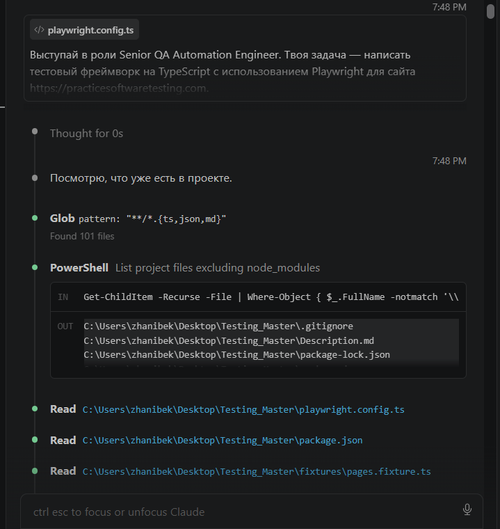
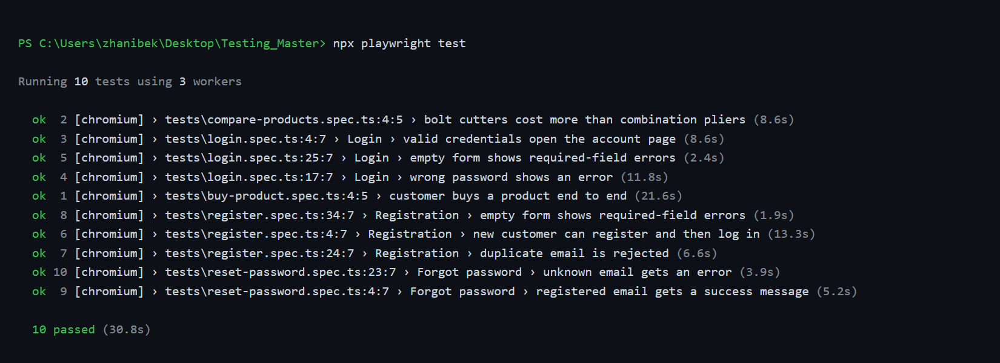
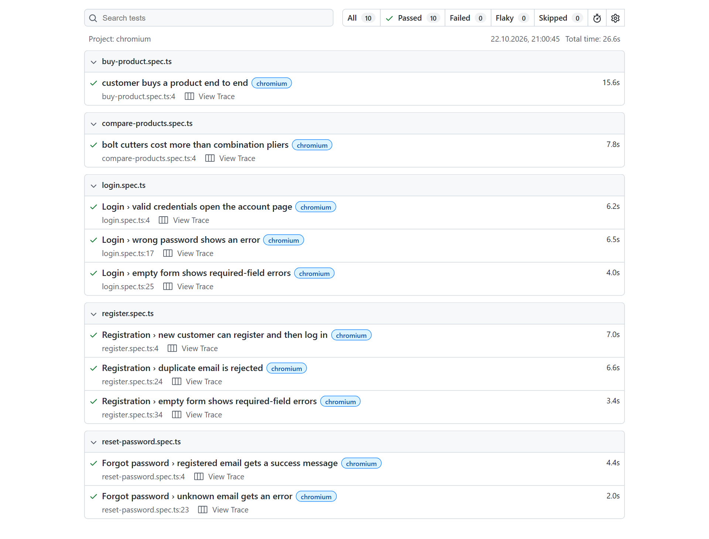
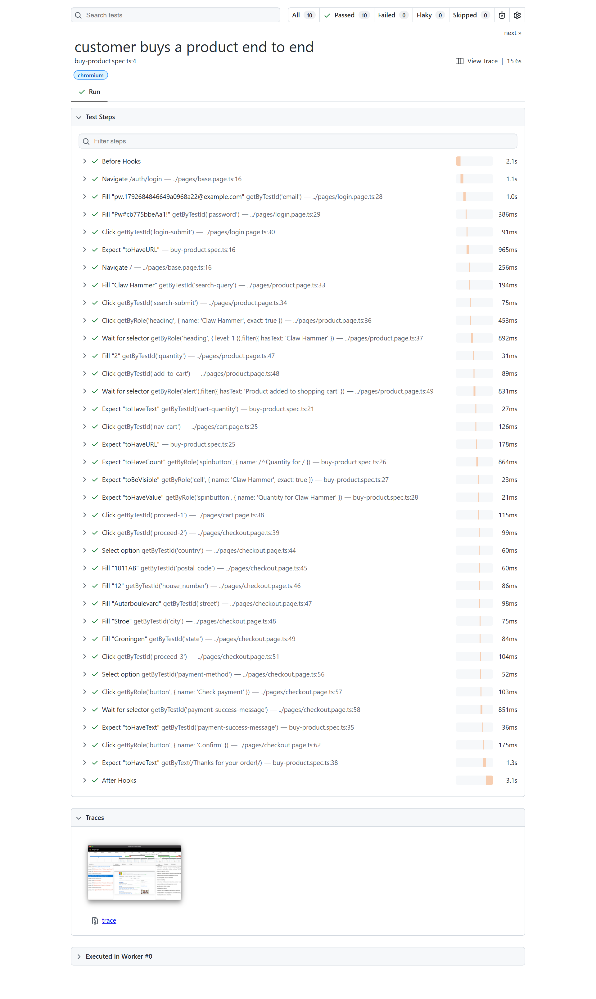
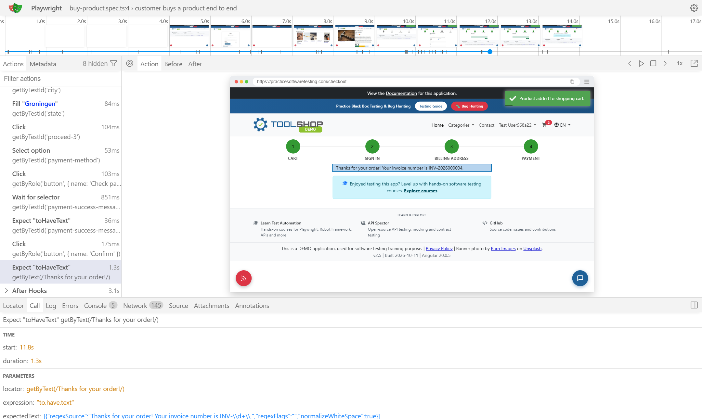

# SIS 2 — Playwright test automation for the Toolshop

End-to-end tests for <https://practicesoftwaretesting.com> written with **Playwright + TypeScript**.

| Document | What is in it |
|---|---|
| [Description.md](Description.md) | Goal, scope and the full **list of test cases** |
| [Prompt.md](Prompt.md) | The exact AI prompts and the tool/model used |
| [Review.md](Review.md) | What the AI produced, how it was reviewed and changed, and why |
| [screenshots/](screenshots/) | AI answer, run result, HTML report, trace viewer — shown [below](#screenshots) |

## How to run

Requires Node.js 20+.

```bash
npm install
npx playwright install chromium
npx playwright test          # all tests, headless
npx playwright test --ui     # UI mode: pick tests, time-travel through steps
npx playwright show-report   # open the last HTML report
```

No accounts or secrets are needed: every test creates its own customers.

## Screenshots

### 1. The AI answer with the first version of the code



### 2. Test run — `npx playwright test`



### 3. HTML report — `npx playwright show-report`



Steps of the end-to-end purchase test in the report:



### 4. Trace viewer — the purchase test at its last step, the invoice number



## What it covers

| # | Test case | Spec | Tests |
|---|---|---|---|
| 1 | Register a new customer | `tests/register.spec.ts` | new account → login page → can log in · duplicate email rejected · empty form rejected |
| 2 | Log in | `tests/login.spec.ts` | valid → account page · wrong password → error · empty → validation |
| 3 | Buy a product | `tests/buy-product.spec.ts` | 2 × Claw Hammer → cart: name and quantity → address → Cash on Delivery → invoice number |
| 4 | Compare two products | `tests/compare-products.spec.ts` | names and prices read from two product pages; Bolt Cutters cost more than Combination Pliers |
| 5 | Reset a password | `tests/reset-password.spec.ts` | registered email → success · unknown email → "The selected email is invalid." |

## Structure

```
tests/        one spec per test case — assertions only, no locators
pages/        one page object per screen — locators and business actions, no assertions
fixtures/     pages.fixture.ts — extends the base `test`, hands page objects and users to every test
data/         user.factory.ts (unique customer data), toolshop.api.ts (API seeding), products.ts, env.ts
```

- Specs contain **no locators**; they say *what*, page objects say *how*.
- `testIdAttribute: 'data-test'` — the app marks elements with `data-test`.
- Locators: `getByTestId`, `getByRole`, `getByText` only — no CSS classes, no XPath.
- No `waitForTimeout`: web-first `expect` assertions and auto-waiting actions.
- Each test creates the data it needs, so tests run **in parallel and in any order**.

## Design notes

- **Own accounts instead of `customer@practicesoftwaretesting.com`.** The seeded account is shared by
  everyone practising on the site and is often locked ("Account locked, too many failed attempts").
  The `registeredUser` fixture registers a fresh customer through the API instead.
- **Products by name, not id.** Product ids are ULIDs that change when the demo database is reseeded.
- **Billing address from the postcode lookup.** The checkout auto-fills street/city/state from
  `/postcode-lookup` and rejects an address that does not match it, so the factory takes the
  address from the same endpoint.

## What I chose not to automate

- Payment methods other than *Cash on Delivery*, and guest checkout — same flow, more form fields.
- Firefox / WebKit — the app is a shared public server; one browser keeps the load polite.
- Clean-up of created customers — the public API has no endpoint for a customer to delete their account.

## Known defects found on the live site

1. Forgot-password for a registered email shows the raw translation key `page.forgot-password.confirm` instead of a message.
2. Forgot-password with a malformed email shows an empty error box.
3. The seeded accounts get locked by other users' failed logins — this suite never uses them.
4. The demo database is periodically reset; for a few seconds the API answers `500 Something went wrong`.
   Retries are enabled on CI for that reason.
